[README.md](https://github.com/user-attachments/files/33897369/README.md)
<p align="center">
  
</p>

<p align="center">
  <a href="https://github.com/shifyee?tab=followers">
    
  </a>
  
  <a href="https://youtube.com/@shifyee">
    
  </a>
</p>

<h3 align="center"><code>$ github-readme-stats --live</code></h3>

<p align="center">
  
  
</p>

<p align="center">
  
</p>

<h3 align="center"><code>$ ls pinned/</code></h3>

<p align="center">
  <a href="https://github.com/shifyee/StudySync">
    
  </a>
  <a href="https://github.com/shifyee/offlinetube">
    
  </a>
</p>
<p align="center">
  <a href="https://github.com/shifyee/Deltamath-Helper">
    
  </a>
</p>

<p align="center"><sub><em>rendered by a terminal that doesn't exist, on a machine that does</em></sub></p>

<br/>

<details>
<summary><strong>⚙️ setup — how this becomes your live profile page</strong></summary>

<br/>

GitHub turns a repo into your profile page only if it's named **exactly** like your username. Here's the full path:

1. Create a new **public** repository named `shifyee` (your GitHub username, nothing else).
   GitHub will show a banner offering to scaffold a profile README — you can ignore that and just push these files instead.
2. Add these two files/folders to the repo root, keeping the folder structure intact:
   ```
   shifyee/
   ├── README.md
   └── assets/
       └── terminal-banner.svg
   ```
3. Commit and push to the default branch.
4. Visit `github.com/shifyee` — the banner and the live badges below it render automatically.

**Why it's split this way:** GitHub strips `<style>` blocks and inline `<script>` out of README markdown, so a "live" animated terminal can't be built as raw HTML in the README itself. The animation (typing, rain, the red/green glitch) lives entirely inside `terminal-banner.svg` as self-contained CSS/SMIL — that's a real image file your browser animates natively, the same mechanism used by every other animated GitHub-profile widget. Everything below the banner (followers, profile views, commit stats, streak, pinned-repo cards) is pulled live at *view time* from GitHub's API by public badge services, so those numbers are never stale and need no maintenance from you.

**If you want different wording in the `whoami` / `cat socials.log` lines:** that text is drawn as real, editable `<text>` inside the SVG, so you *can* open it in any text editor and swap the words directly — but each line's typing animation is clipped to the pixel-width of the original string, so a same-length swap (e.g. `toolsmith` → `developer`) is safe, while a much longer replacement will get visually cut off. For anything longer than a word or two, it's cleaner to ask me to regenerate the SVG with new copy — it's a scripted build, not hand-drawn, so that takes seconds.

**Wiring up a live YouTube subscriber count:** the badge above links to your channel but doesn't show a subscriber count, because that specific badge needs your channel's `UC…` ID (not just the `@shifyee` handle), and I didn't want to guess or fabricate a number. Once you have it (Channel → Settings → Advanced → "Channel ID"), swap the badge line for:
   ```
   https://img.shields.io/youtube/channel/subscribers/UCxxxxxxxxxxxxxxxxxxxxxx?style=for-the-badge&logo=youtube&color=ff2d55&labelColor=05070f
   ```

**Customizing the palette:** every badge URL above takes hex colors with no `#` — `05070f` (background), `ff2d55` (red), `3dff7a` (green), `c9ffd9` (pale green text), `16214a` (border). Change any of those in place to retheme every card at once.

</details>
